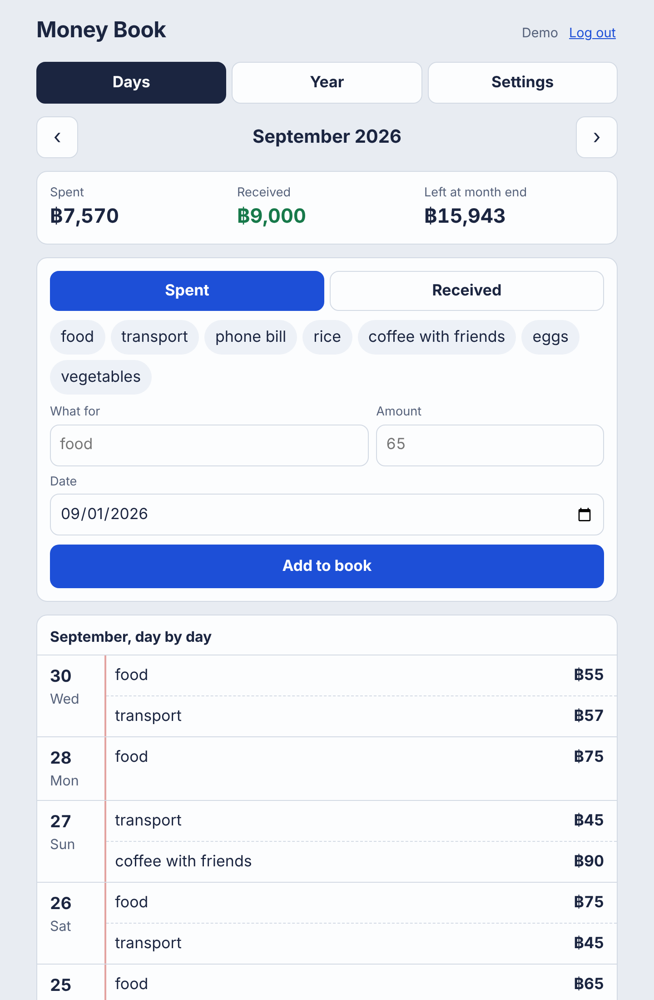
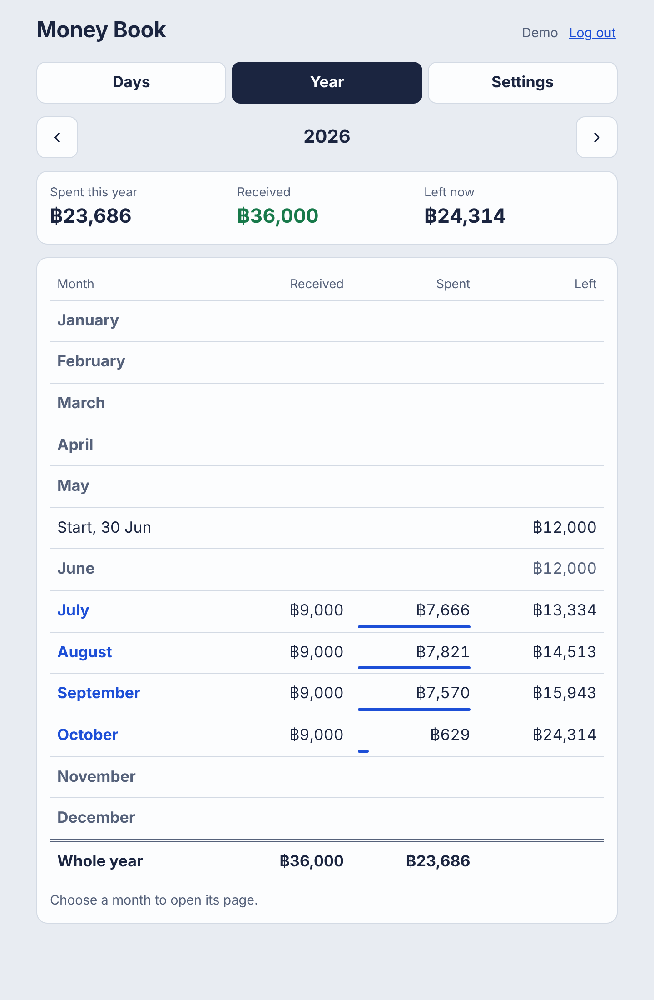
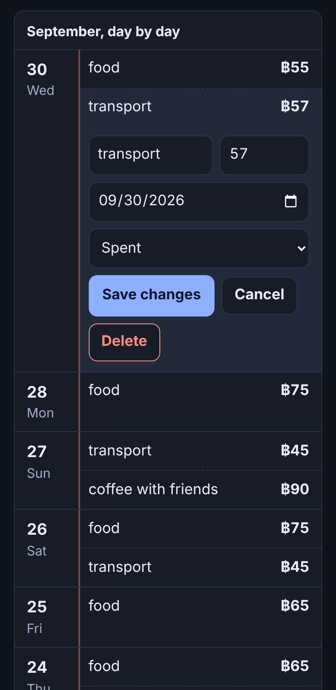

# Money Book

A personal finance app for people who keep a spending notebook. You write down
what you spent each day; the book adds it up by month and by year and tells you
how much money is left.

It began as two pages of a real paper notebook: one page listing daily spending
for a month, and one page carrying a balance from month to month. The app keeps
those two pages and does the adding up.



| The year at a glance | On a phone, in dark mode |
| --- | --- |
|  |  |

## What it does

- **Days.** One month at a time. Add an entry with what it was for, the amount
  and the date. Entries appear like a notebook page, newest day first, with the
  month's total under a double rule and a "where it went" breakdown.
- **Quick choices.** The things you write most often lately (food, transport,
  rice) become one-press buttons that also fill in the last amount you paid.
- **Year.** Twelve months side by side: received, spent, and the money left at
  the end of each month, carried forward from your starting balance.
- **Change your mind.** Press any line to correct it, move it to another date,
  or delete it; the message that follows offers Undo for a few seconds.
- **History.** Every change is written down: what was added, changed or
  deleted (with the entry as it was), settings changes, restores, erases, and
  each log-in. A wrong-password attempt on your account shows up in red, so
  you know to change your password (Settings), which logs out every other
  device.
- **Your own copy.** Save the whole book as a backup file, restore from one, or
  save it as a spreadsheet for Excel or Google Sheets.
- **Private.** Each person signs up for their own book. Nobody sees anyone
  else's entries.
- **Readable.** Large type, a typeface designed for legibility, light and dark
  mode (follows the device, or pick one at the top of the page), and a layout
  that fits a 320-pixel-wide phone.
- **Four languages.** English, Burmese (မြန်မာ), Thai (ไทย) and Chinese (中文),
  chosen at the top of the page; the first visit follows the browser's
  language. The words live in `lib/i18n/`, one file per language.

## Built with

Next.js 16 (App Router, Server Components, Server Actions) · React 19 ·
MySQL 8 with `mysql2` · plain CSS · Node's built-in test runner. Plain
JavaScript throughout, and no libraries beyond those four packages: sign-in,
validation and the money arithmetic are written out in `lib/` so they can be
read and tested.

## Run it

You need Node 22 or newer and MySQL 8.

```bash
npm install
cp .env.example .env.local      # then put your MySQL details in .env.local
npm run db:setup                # creates the tables
npm run seed                    # optional: a demo account with made-up entries
npm run dev                     # http://localhost:3000
```

Create the database and user first if you do not have them:

```sql
CREATE DATABASE moneybook CHARACTER SET utf8mb4;
CREATE USER 'moneybook'@'localhost' IDENTIFIED BY 'choose-a-password';
GRANT ALL ON moneybook.* TO 'moneybook'@'localhost';
```

`npm run seed` prints the demo account's email and password. Or sign up for
your own book on the first page.

### With Docker

```bash
docker compose up --build       # MySQL and the app; then open http://localhost:3000
```

The compose file was written carefully but has **not been run**: the machine
this was developed on had no Docker available. Everything else below was run.

### Tests

```bash
npm test
```

31 tests run with no database: money parsing and formatting, dates, the
carried-forward balance, quick-choice ranking, the year table, backup files,
the spreadsheet export, form validation, the history's wording and the log-in
limiter. 18 more run against a real MySQL
when you point them at an **empty test database** (they drop and recreate the
tables):

```bash
MYSQL_TEST_DATABASE=moneybook_test MYSQL_TEST_USER=moneybook MYSQL_TEST_PASSWORD=... npm test
```

Those cover what only a database can prove: one person cannot read or change
another's entries, a failed restore leaves the old book untouched, the totals
of 1,201 entries of 0.10 come to exactly 120.10, and deleting a user removes
their book.

## How it is put together

```
app/
  page.js            Days: one month (Server Component, reads the database)
  year/page.js       Year: twelve months and the running balance
  history/page.js    History: every change and log-in, newest first
  settings/page.js   Starting balance, backup, password, erase
  login, signup      Account pages
  actions.js         Server Actions: every change to the book goes through here
  api/backup         GET: the whole book as a JSON file
  api/export         GET: the whole book as a CSV file
  api/health         GET: 200 when the database answers, for a host's health check
components/          The interactive parts (Client Components): forms, the day list, toasts
lib/
  money.js           Amounts as whole minor units; parsing and formatting
  dates.js           Dates as "2026-09-30" text; month stepping; "today" in a time zone
  book.js            The arithmetic: money left, quick choices, the year table
  history.js         The history in words
  backup.js          Reading and writing backup files; the CSV export
  validate.js        Checks on everything that arrives from a form
  repos/             All the SQL, one function per question asked of the database
  auth/              Password hashing, sessions, the current user
  schema.sql         Six tables: users, sessions, settings, entries, history, attempts
test/                Unit tests and database tests
```

A page request works like this: the Server Component asks `lib/repos` for the
month's entries and the monthly totals, hands them to the pure functions in
`lib/book.js`, and renders HTML. Only the forms and the day list ship
JavaScript to the browser. When a form is sent it calls a Server Action, which
checks who is logged in, validates the input, writes to MySQL and tells Next.js
the book changed, so the page re-renders with the new figures.

## Decisions worth explaining

**Money is stored as whole numbers.** 65.50 is saved as 6550. Fractions like
0.1 have no exact binary form, so adding thousands of them as floating point
drifts by a satang here and there. Whole numbers do not. Amounts are parsed
from the text the person typed, not through `Number()`, so 1.005 becomes 1.01.

**The database does the adding up.** The Year page is one `GROUP BY` query
that returns a row per month, however many entries the book holds. The running
balance is then a short loop over at most a few dozen rows.

**"Left" is honest about what it knows.** Money left = starting balance + what
was received − what was spent since. Entries dated on or before the starting
date are shown but not counted again, because they are already inside the
starting balance. With no starting balance and nothing received, the app shows
"?" and says what to do, instead of a meaningless negative number.

**Every query names its owner.** Every function in `lib/repos/book.js` takes
the user's id and puts it in the `WHERE` clause. Changing or deleting someone
else's entry affects zero rows and is reported as "does not exist", so the app
does not even confirm that the entry is there.

**Sign-in without a library**, to show how it works:

- Passwords are hashed with scrypt (slow and memory-hard on purpose), each with
  its own salt. The parameters are stored in the hash so they can be raised later.
- A session is a random token in an `httpOnly`, `SameSite=Lax` cookie. The
  database stores only the token's SHA-256 hash, so a leaked database cannot be
  used to log in as anyone. Logging out deletes the row.
- Logging in with an unknown email takes as long as a wrong password and gives
  the same message, so the form does not reveal who has an account.
- Every fifteen minutes: ten log-in attempts per email, thirty per network
  address, ten sign-ups per address, ten tries at the current password when
  changing it. The counts are kept in the database, so they hold across
  restarts and across several servers. The network address is read from the
  proxy in front of the app (`TRUSTED_PROXIES`), never from what the browser
  says.
- Server Actions refuse calls that come from another website (Next.js compares
  the `Origin` header with the host). I replayed a real "add entry" request
  with a different origin and with no cookie; both were refused and nothing was
  saved.

**The history is written with the change.** Each change and its line in
the history are one transaction, so the history never shows something that
did not happen. It keeps a copy of the entry as it was, so a deleted entry can
still be read there. "Erase everything" keeps the history (with a line saying
what went); it can be cleared on its own from the History page.

**A backup file is treated as something a stranger wrote.** Restoring reads
only the fields the app itself writes, checks every date and amount, skips
damaged lines and keeps the rest. The replacement happens in one transaction:
if it fails half-way, the old book is still there. The spreadsheet export
puts an apostrophe in front of labels that begin with `=`, `+`, `-` or `@`, so
opening the file can never run a formula someone typed as a label.

**Dates are text, not `Date` objects.** A date column read as a JavaScript
`Date` picks up the server's time zone and can come out as the day before.
The connection uses `dateStrings`, so `2026-09-30` stays `2026-09-30`. The
server's idea of "today" comes from `APP_TIME_ZONE`; the add form then corrects
it to the browser's own date.

## What it does not do

- Two decimal places are assumed for every money sign. Currencies with none
  (yen) work; currencies with three do not.
- One book per account, and no sharing a book between people.
- No password reset: that needs to send email, which this project does not do.
- The limits per network address need the app behind a proxy (nginx, a load
  balancer, Vercel). Served directly, a browser can claim any address.
- Categories are just the labels you type. "food" and "Food" are counted
  together; "lunch" is its own line.
- On a host that is not `localhost`, the app must be served over HTTPS: in
  production the session cookie is marked `Secure`.

## What I would add next

Budgets per label with a warning as the month fills up, a monthly comparison
chart, recurring entries (rent on the 5th), and a Burmese and Thai interface.
